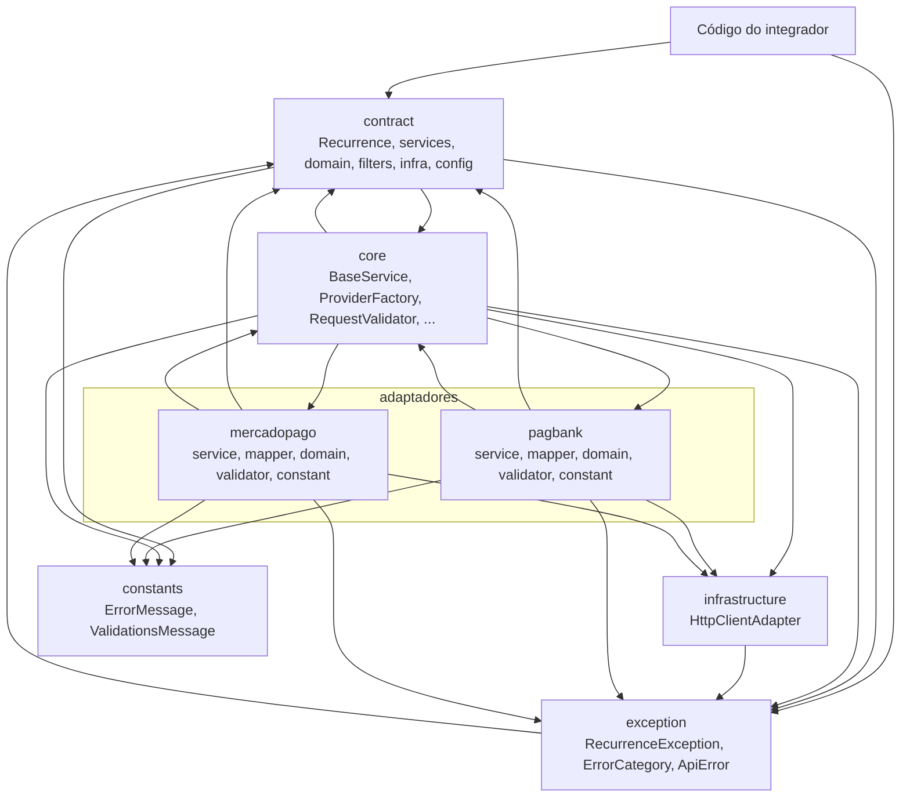
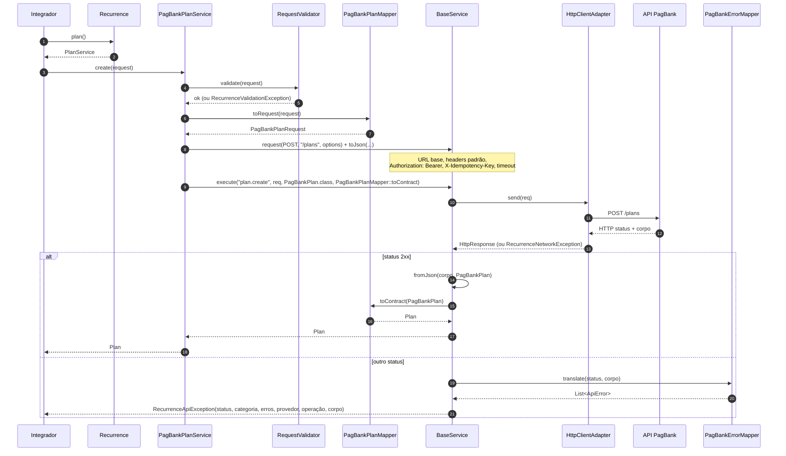

# Arquitetura

A biblioteca separa o que o integrador usa (o contrato) do que fala com cada provedor (os
adaptadores). O código do integrador só conhece tipos de `com.recurrence.contract` e
`com.recurrence.exception`; os DTOs e as URLs de cada provedor ficam escondidos nos
adaptadores.

## 1. Pacotes

Todos sob `com.recurrence`:

| Pacote | Papel | Classes principais |
|---|---|---|
| `contract` | API pública: ponto de entrada e interfaces de serviço | `Recurrence`, `RecurrenceProvider`, `PlanService`, `SubscriptionService`, `InvoiceService`, `CardService` |
| `contract.config` | configuração | `ProviderConfig`, `Provider`, `Environment` |
| `contract.domain` | entidades devolvidas pelos services | `Plan`, `Subscription`, `Invoice`, `Payment` |
| `contract.domain.commons` | tipos de valor | `Amount`, `PlanInterval`, `PlanTrial`, `BillingInfo`, `Card`, `Phone`, `PlanReference`, `CustomerReference` |
| `contract.domain.enums` | enums canônicos | `PlanStatus`, `SubscriptionStatus`, `InvoiceStatus`, `PaymentStatus`, `PaymentMethodType`, `PlanIntervalType`, `Currency` |
| `contract.domain.request` | dados de entrada | `CreatePlanRequest`, `UpdatePlanRequest`, `CreateSubscriptionRequest`, `UpdateSubscriptionRequest`, `CustomerRequest`, `TokenizeCardRequest` |
| `contract.filters` | paginação e filtros | `PageOptions`, `PlanFilter`, `SubscriptionFilter`, `PaymentFilter` |
| `contract.infra` | resposta paginada e opções por chamada | `PageResponse`, `RequestOptions` |
| `exception` | erros da biblioteca | `RecurrenceException` e subclasses, `ErrorCategory`, `ApiError` |
| `core` | núcleo comum aos adaptadores | `BaseService`, `ProviderContext`, `ProviderFactory`, `ProviderErrorTranslator`, `RequestValidator`, `EnvironmentConfigLoader`, `QueryParams`, `Converter` |
| `infrastructure` | cliente HTTP | `HttpClientAdapter`, `HttpRequestRecurrence`, `MethodRequest` |
| `constants` | mensagens de erro | `ErrorMessage`, `ValidationsMessage` |
| `pagbank`, `mercadopago` | adaptadores | `PagBankProvider`, `MercadoPagoProvider` |

Cada adaptador tem a mesma estrutura interna:

| Subpacote | Conteúdo | Exemplo (PagBank / Mercado Pago) |
|---|---|---|
| raiz | o provedor, que implementa `RecurrenceProvider` e valida a configuração | `PagBankProvider` / `MercadoPagoProvider` |
| `service` | um service por interface do contrato, estendendo `BaseService` | `PagBankPlanService` / `MercadoPagoPlanService` |
| `mapper` | conversões contrato ↔ DTO, filtros e erros | `PagBankPlanMapper`, `PagBankErrorMapper` / `MercadoPagoPlanMapper`, `MercadoPagoErrorMapper` |
| `domain` | DTOs (records) no formato JSON do provedor | `PagBankPlan` / `MercadoPagoPlan` |
| `validator` | regras de validação que só valem para o provedor | `SubscriptionValidator` / `CardValidator` |
| `constant` | caminhos, nomes de parâmetros e de operações | `pagbank.constant.Constant` / `mercadopago.constant.Constant` |

### 1.1 Dependências entre pacotes

Dependências extraídas dos `import` do código (a seta indica "usa"):

`pagbank` e `mercadopago` não dependem um do outro.

Duas observações sobre o diagrama:

- O integrador depende só de `contract` e `exception`. Nenhuma assinatura pública do
  contrato menciona um tipo de `pagbank` ou `mercadopago`.
- Há um ciclo de pacotes por construção: `contract.Recurrence` chama
  `core.ProviderFactory`, que instancia `PagBankProvider` e `MercadoPagoProvider`, e
  esses implementam as interfaces de `contract`. É o ponto onde o provedor concreto é
  escolhido. `contract.config.ProviderConfig` também usa `core.EnvironmentConfigLoader`
  para ler as variáveis de ambiente, e `exception.RecurrenceApiException` guarda o
  `contract.config.Provider` que falhou.

## 2. Fluxo de uma chamada

Exemplo: `recurrence.plan().create(request)` com o PagBank ativo.

O caminho é o mesmo para todas as operações e para o Mercado Pago; muda só o service,
o mapper e o tradutor de erros. Operações sem corpo de resposta (`activate`, `cancel`,
...) usam `BaseService.execute(operation, request)`, que descarta o corpo.

Algumas operações compõem mais de uma chamada dentro do service:

| Operação | Composição |
|---|---|
| `subscription().update` no PagBank | `GET /subscriptions/{id}` (para o `customer.id`) → `PUT /customers/{id}/billing_info` → `PUT /subscriptions/{id}` → `GET /subscriptions/{id}`, conforme os campos informados |
| `subscription().update` no Mercado Pago | `PUT /preapproval/{id}` → `GET /preapproval/{id}` |
| `invoice().listPayments(invoiceId)` no Mercado Pago | `GET /authorized_payments/{id}` → `GET /v1/payments/{payment.id}` |
| `card().tokenize` no PagBank | `GET /public-keys` (só na primeira vez, se a chave não estiver na configuração) → criptografia local |

## 3. Padrões de projeto

| Padrão | Onde | Para quê |
|---|---|---|
| **Facade** | `Recurrence` | Um único ponto de entrada que esconde a escolha do provedor e entrega os quatro services. |
| **Abstract Factory** | `RecurrenceProvider`, implementado por `PagBankProvider` e `MercadoPagoProvider` | Cada provedor cria a sua família de services (`planService()`, `subscriptionService()`, `invoiceService()`, `cardService()`), que compartilham o mesmo `ProviderContext`. |
| **Factory Method** (estático) | `ProviderFactory.create(provider, environment, config)` | Escolhe a implementação de `RecurrenceProvider` a partir do enum `Provider`, com `switch` exaustivo. |
| **Adapter** | `PagBankPlanService`, `MercadoPagoSubscriptionService`, ... e os mappers (`PagBankPlanMapper`, `MercadoPagoInvoiceMapper`, ...) | Adaptam a API de cada provedor às interfaces do contrato. |
| **Strategy** | `ProviderErrorTranslator` (`PagBankErrorMapper`, `MercadoPagoErrorMapper`); a `Function<P, T>` passada a `BaseService.execute` | O pipeline de `BaseService` é fixo; o parsing do erro e a conversão da resposta são plugados por provedor e por operação. |
| **Builder** | `ProviderConfig.Builder`, `RequestOptions.Builder`, `PageOptions.Builder`, os builders das entidades, dos requests e dos filtros, `HttpRequestRecurrence.Builder` | Objetos imutáveis com muitos campos opcionais. |
| **Value Object** | `Amount`, `PlanInterval`, `PlanTrial`, `PlanReference`, `CustomerReference`, `ApiError` (records) | Valores imutáveis comparados por conteúdo. |

`BaseService` não é um *Template Method* clássico: não define passos abstratos que as
subclasses sobrescrevem. É uma superclasse com o pipeline comum (`request` monta a
requisição, `execute` envia, verifica o status, desserializa e converte), que os services
concretos chamam passando o que varia como parâmetro.

## 4. Decisões de projeto

| Decisão | Motivo | Custo |
|---|---|---|
| **Biblioteca, não serviço** | O integrador adiciona um jar; não há processo a mais para operar, nem latência de rede extra, nem um terceiro guardando credenciais. | A atualização depende de cada integrador trocar a versão. Não há ponto central para logs ou métricas. |
| **DTOs do provedor nunca aparecem no contrato** | Trocar de provedor não muda nenhum tipo no código do integrador. | Campos que só um provedor tem ficam inacessíveis (cupons, `init_point`, boleto). Para eles, use o SDK do provedor. |
| **Interseção dos provedores no contrato** | Cada campo e operação do contrato funciona nos dois provedores, ou é recusado de forma explícita. Os critérios estão em [`criterios.md`](criterios.md). | Alguns campos ficam `null` num provedor (seção 4 de [`modelo-canonico.md`](modelo-canonico.md)). |
| **Validação antes da rede** | Erros de uso aparecem como `RecurrenceValidationException`, iguais nos dois provedores e sem gastar uma chamada. Regras comuns em `RequestValidator`; regras próprias em `validator/`. | As regras dos provedores ficam duplicadas na biblioteca e podem ficar desatualizadas se o provedor mudar. |
| **Recusar em vez de fingir sucesso** | Troca de plano no Mercado Pago e filtros sem equivalente lançam exceção (critério 5 de [`criterios.md`](criterios.md)). | O integrador precisa tratar a recusa. |
| **Valores em centavos (`Integer`)** | Sem erro de arredondamento no contrato; o PagBank já usa centavos. | O adaptador do Mercado Pago converte de e para decimal. |
| **Estados desconhecidos viram `UNKNOWN`** | Um status novo do provedor não quebra a leitura. | O integrador precisa tratar `UNKNOWN`. |
| **Exceções não checadas com categoria** | `ErrorCategory` permite tratar erros sem conhecer o formato de cada provedor; `getRawBody()` preserva o original para diagnóstico. | Nada obriga o integrador a capturar as exceções. |
| **Só `java.net.http` e Jackson** | Poucas dependências para quem usa a biblioteca (Java 16+). | O cliente HTTP é simples: sem retentativa automática nem log. |
| **`backUrl` no `ProviderConfig` compartilhado** | O Mercado Pago exige `back_url`; validar na configuração (obrigatório num, proibido no outro) falha cedo e de forma explícita. | É o único campo de um provedor só num tipo comum. Está registrado como exceção em [`criterios.md`](criterios.md). |
