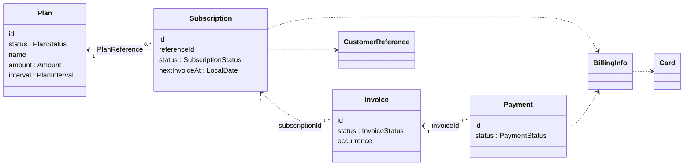

# Modelo canônico

Este documento descreve o contrato público da biblioteca (`com.recurrence.contract`)
como ele está implementado, e como cada tipo é convertido de e para o PagBank e o
Mercado Pago. Tudo aqui foi conferido contra o código dos mappers e dos services de
cada adaptador. Os critérios usados para decidir o que entra no contrato estão em
[`criterios.md`](criterios.md).

## 1. Escopo

### 1.1 Incluído

| Serviço | Operações |
|---|---|
| `PlanService` | `create`, `get`, `list`, `update`, `activate`, `deactivate` |
| `SubscriptionService` | `create`, `get`, `list`, `update`, `suspend`, `cancel`, `activate` |
| `InvoiceService` | `getInvoice`, `getPayment`, `listPayments(invoiceId, ...)`, `listPayments(pageOptions, ...)`, `listInvoiceBySubscription` |
| `CardService` | `tokenize` |

São 19 operações. Além delas, o contrato tem paginação (`PageOptions`/`PageResponse`),
filtros (`PlanFilter`, `SubscriptionFilter`, `PaymentFilter`), opções por chamada
(`RequestOptions`) e configuração (`ProviderConfig`, `Provider`, `Environment`).

Meio de pagamento aceito: **só cartão de crédito** (`PaymentMethodType.CREDIT_CARD`).

### 1.2 Excluído

| Fora do contrato | Motivo |
|---|---|
| Assinante como recurso próprio (`Customer`, `CustomerService`) | No Mercado Pago o pagador existe só dentro da assinatura. O assinante aparece no contrato apenas como `CustomerReference(id, name, email)` nas respostas e como `CustomerRequest` na criação da assinatura. |
| Estorno (`Refund`) | Não faz parte do produto de assinaturas do Mercado Pago. Fica como trabalho futuro. |
| Cupons, preferências de retentativa e de notificação, retentativa manual | Recursos exclusivos do PagBank. |
| Exportação de assinaturas | Recurso exclusivo do Mercado Pago. |
| Busca geral de faturas | O PagBank só lista faturas por assinatura. |
| Assinatura sem plano e checkout por link (`init_point`) | Fluxos exclusivos do Mercado Pago. |
| Boleto e outros meios de pagamento | O Mercado Pago não oferece boleto em assinaturas. Valores desconhecidos nas respostas viram `PaymentMethodType.UNKNOWN`. |
| Webhooks e notificações | Payloads e validação são diferentes em cada provedor. |

## 2. Visão do domínio

As entidades se ligam **por referência**, não por objeto embutido: a assinatura traz
`PlanReference(id, name)` e `CustomerReference(id, name, email)`, a fatura traz
`subscriptionId` e o pagamento traz `invoiceId`. Para o objeto completo, consulte o
service correspondente.

Uma **fatura** é a cobrança de um ciclo da assinatura (PagBank `invoice`, Mercado Pago
`authorized_payment`). Um **pagamento** é uma tentativa de cobrar essa fatura (PagBank
`payment`, Mercado Pago `/v1/payments`).

Todas as entidades e requests são imutáveis e montadas por *builder*. Os tipos de
valor pequenos são `record`.

## 3. Tipos de valor (`contract.domain.commons`)

| Tipo | Forma | Campos | Observações |
|---|---|---|---|
| `Amount` | record | `Integer value`, `Currency currency` | `value` em **centavos** (`4990` = R$ 49,90). Deve ser maior que zero nos pedidos. |
| `PlanInterval` | record | `PlanIntervalType type`, `Integer frequency` | `frequency` maior que zero. `MONTH, 12` é anual. |
| `PlanTrial` | record | `Integer days` | Período de teste em dias, maior que zero. |
| `BillingInfo` | classe com builder | `PaymentMethodType type`, `Card card` | Meio de pagamento. É classe, e não record, para aceitar outros meios no futuro sem quebrar o contrato. |
| `Card` | classe com builder | `token`, `securityCode`, `brand`, `lastDigits` | Nos pedidos: `token` (obrigatório) e `securityCode` (CVV). Nas respostas: só `brand` e `lastDigits`, quando o provedor devolve. |
| `Phone` | classe com builder | `Integer id`, `area`, `country`, `number` | Telefone do assinante. O `id` não é enviado nem preenchido por nenhum adaptador. |
| `PlanReference` | record | `id`, `name` | Plano resumido dentro de assinaturas e faturas. |
| `CustomerReference` | record | `id`, `name`, `email` | Assinante resumido. Qualquer campo pode vir `null`, conforme o provedor (veja as tabelas abaixo). |

O que vai em `Card.token` depende do provedor ativo:

| | PagBank | Mercado Pago |
|---|---|---|
| `token` | cartão criptografado (`encrypted`), gerado pelo SDK JS do PagBank ou por `card().tokenize(...)` | `card_token_id`, gerado pelo SDK JS do Mercado Pago ou por `card().tokenize(...)`; uso único e validade curta |
| `securityCode` | **obrigatório** na criação da assinatura e na troca de cartão | ignorado (o CVV já está dentro do token) |

## 4. Entidades

Nas tabelas, "—" significa que o adaptador deixa o campo `null`.

### 4.1 `Plan`

| Campo | Tipo | PagBank (`/plans`) | Mercado Pago (`/preapproval_plan`) |
|---|---|---|---|
| `id` | `String` | `id` | `id` |
| `status` | `PlanStatus` | `status` (seção 6) | `status` (seção 6) |
| `name` | `String` | `name` | `reason` |
| `amount` | `Amount` | `amount.value` (centavos), `amount.currency` | `auto_recurring.transaction_amount` (decimal → centavos), `auto_recurring.currency_id` |
| `interval` | `PlanInterval` | `interval.length` + `interval.unit` (`YEAR` vira `MONTH × 12`) | `auto_recurring.frequency` + `auto_recurring.frequency_type` (`days`, `months`) |
| `billingCycles` | `Integer` | `billing_cycles` | `auto_recurring.repetitions` |
| `trial` | `PlanTrial` | `trial.days`, só quando `trial.enabled = true` | `auto_recurring.free_trial` (em meses vira `meses × 30` dias) |
| `paymentMethods` | `List<PaymentMethodType>` | `payment_method[]` | `payment_methods_allowed.payment_types[].id` |
| `createdAt` | `OffsetDateTime` | `created_at` | `date_created` |
| `updatedAt` | `OffsetDateTime` | `updated_at` | `last_modified` |

### 4.2 `Subscription`

| Campo | Tipo | PagBank (`/subscriptions`) | Mercado Pago (`/preapproval`) |
|---|---|---|---|
| `id` | `String` | `id` | `id` |
| `referenceId` | `String` | `reference_id` | `external_reference` |
| `status` | `SubscriptionStatus` | `status` (seção 6) | `status` (seção 6) |
| `amount` | `Amount` | `amount` | `auto_recurring.transaction_amount` + `currency_id` |
| `plan` | `PlanReference` | `plan.id`, `plan.name` | `preapproval_plan_id`, `reason` |
| `customer` | `CustomerReference` | `customer.id`, `customer.name`, `customer.email` | `payer_id`, —, `payer_email` (vazio vira `null`; o sandbox devolve vazio nas consultas) |
| `paymentMethod` | `BillingInfo` | primeiro item de `payment_method[]`: tipo, `card.brand`, `card.last_digits` | `CREDIT_CARD` se houver `card_id`, senão `UNKNOWN`; `brand` = `payment_method_id`; `lastDigits` — |
| `nextInvoiceAt` | `LocalDate` | `next_invoice_at` (só a data) | `next_payment_date` (só a data) |
| `expAt` | `LocalDate` | `exp_at` (só a data) | `auto_recurring.end_date` (só a data) |
| `createdAt` | `OffsetDateTime` | `created_at` | `date_created` |
| `updatedAt` | `OffsetDateTime` | `updated_at` | `last_modified` |

### 4.3 `Invoice`

| Campo | Tipo | PagBank (`/invoices`) | Mercado Pago (`/authorized_payments`) |
|---|---|---|---|
| `id` | `String` | `id` | `id` (o sandbox só atribui alguns segundos depois da cobrança) |
| `status` | `InvoiceStatus` | `status` (seção 6) | `status` combinado com `payment.status` (seção 6) |
| `occurrence` | `Integer` | `occurrence` (número do ciclo) | — |
| `amount` | `Amount` | `amount` | `transaction_amount` + `currency_id` |
| `subscriptionId` | `String` | `subscription.id` | `preapproval_id` |
| `plan` | `PlanReference` | `plan.id`, `plan.name` | — (consulte a assinatura) |
| `customer` | `CustomerReference` | `customer.id`, `customer.name`, `customer.email` | `payer_id`, —, — |
| `createdAt` | `OffsetDateTime` | `created_at` | `date_created` |
| `updatedAt` | `OffsetDateTime` | `updated_at` | `last_modified` |

### 4.4 `Payment`

| Campo | Tipo | PagBank (`/payments`) | Mercado Pago (`/v1/payments`) |
|---|---|---|---|
| `id` | `String` | `id` | `id` |
| `status` | `PaymentStatus` | `status` (seção 6) | `status` (seção 6) |
| `invoiceId` | `String` | `invoice.id` | — em `getPayment` e na listagem geral; preenchido em `listPayments(invoiceId)` |
| `amount` | `Amount` | `invoice.amount` (o pagamento do PagBank não traz valor) | `transaction_amount` + `currency_id` |
| `paymentMethod` | `BillingInfo` | `payment_method`: tipo, `card.brand`, `card.last_digits` | `payment_type_id`; `brand` = `payment_method_id`; `lastDigits` = `card.last_four_digits` |
| `customer` | `CustomerReference` | `customer.id`, `customer.name`, `customer.email` | `payer.id`, —, `payer.email` |
| `createdAt` | `OffsetDateTime` | `created_at` | `date_created` |
| `updatedAt` | `OffsetDateTime` | `updated_at` | `date_last_updated` |

No Mercado Pago o `transaction_data.invoice_id` do pagamento é outro identificador e
não serve em `getInvoice` (verificado no sandbox). Por isso `invoiceId` fica `null`
quando a fatura de origem não é conhecida.

## 5. Requests (`contract.domain.request`)

As regras de validação abaixo são aplicadas **antes** de qualquer chamada HTTP e
lançam `RecurrenceValidationException`. As comuns ficam em `core.RequestValidator`;
as de um provedor só ficam no `validator/` do adaptador.

### 5.1 `CreatePlanRequest` e `UpdatePlanRequest`

Mesmos campos: `name`, `amount`, `interval`, `billingCycles`, `trial`, `paymentMethods`.

| Campo | Regra | PagBank | Mercado Pago |
|---|---|---|---|
| `name` | obrigatório na criação; não pode ficar em branco | `name` | `reason` |
| `amount` | obrigatório na criação; `value > 0` e `currency` informada | `amount` (centavos) | `auto_recurring.transaction_amount` (decimal) + `currency_id` |
| `interval` | obrigatório na criação; `type` informado e `frequency > 0` | `interval.length` + `interval.unit` | `auto_recurring.frequency` + `frequency_type` |
| `billingCycles` | opcional; `> 0` | `billing_cycles` | `auto_recurring.repetitions` |
| `trial` | opcional; `days > 0` | `trial.days` com `enabled = true` | `auto_recurring.free_trial` em `days` |
| `paymentMethods` | opcional; só `CREDIT_CARD` | `payment_method` | `payment_methods_allowed.payment_types = [{id: credit_card}]` |
| (configuração) | — | — | `back_url` vem de `ProviderConfig.backUrl`, só na criação |

Na criação, `paymentMethods` nulo vira `[CREDIT_CARD]` nos dois provedores, para o
plano não herdar o padrão do PagBank (que inclui boleto).

Em `UpdatePlanRequest` todos os campos são opcionais (nulo significa "não alterar"),
mas ao menos um precisa ser informado. Só os campos informados vão no corpo do `PUT`;
no Mercado Pago o bloco `auto_recurring` é omitido quando fica vazio.

### 5.2 `CreateSubscriptionRequest`

| Campo | Regra comum | PagBank | Mercado Pago |
|---|---|---|---|
| `planId` | obrigatório | `plan.id` | `preapproval_plan_id` |
| `referenceId` | opcional | **obrigatório**; `reference_id` | `external_reference` |
| `amount` | opcional; sobrescreve o valor do plano | `amount` | `auto_recurring.transaction_amount` + `currency_id` |
| `customer` | obrigatório, com `email` | veja `CustomerRequest` | só `payer_email` |
| `paymentMethod` | obrigatório; `type = CREDIT_CARD` e `card.token` | cartão em `customer.billing_info[]` (`encrypted` + `security_code`) e só o CVV em `payment_method[]`; `card.securityCode` **obrigatório** | `card_token_id` |
| (fixo) | — | — | `status = authorized`, `back_url` da configuração |

### 5.3 `CustomerRequest`

| Campo | PagBank | Mercado Pago |
|---|---|---|
| `name` | **obrigatório**; `customer.name` | não enviado |
| `email` | obrigatório; `customer.email` | obrigatório; `payer_email` |
| `taxId` | **obrigatório**; `customer.tax_id` | não enviado |
| `phone` | **obrigatório**; `customer.phones[0]` (`country`, `area`, `number`) | não enviado |

No PagBank o assinante é criado junto com a assinatura. No Mercado Pago o sandbox exige
que vendedor (dono do token) e assinante sejam ambos usuários de teste.

### 5.4 `UpdateSubscriptionRequest`

Campos opcionais (`planId`, `amount`, `paymentMethod`); ao menos um precisa ser informado.
Ao final, os dois adaptadores consultam a assinatura de novo e devolvem o estado atualizado.

| Campo | PagBank | Mercado Pago |
|---|---|---|
| `planId` | `PUT /subscriptions/{id}` com `plan.id` | `PUT /preapproval/{id}` com `preapproval_plan_id`; no sandbox o provedor responde 2xx e mantém o plano antigo (a assinatura devolvida mostra o plano antigo) |
| `amount` | `PUT /subscriptions/{id}` com `amount` | `PUT /preapproval/{id}` com `auto_recurring.transaction_amount` |
| `paymentMethod` | consulta a assinatura para obter o `customer.id` e chama `PUT /customers/{customer_id}/billing_info`; exige `card.securityCode` | `PUT /preapproval/{id}` com `card_token_id` |

### 5.5 `TokenizeCardRequest`

Campos: `number`, `securityCode`, `expMonth`, `expYear`, `holderName`, `holderTaxId`.

| Regra | Valor |
|---|---|
| `number` | só dígitos, de 13 a 19 |
| `securityCode` | só dígitos, 3 ou 4 |
| `expMonth` | de 1 a 12 |
| `expYear` | de 1900 a 2099 (4 dígitos) |
| `holderName` | obrigatório, sem dígitos |
| `holderTaxId` | opcional na regra comum (11 ou 14 dígitos quando informado); **obrigatório no Mercado Pago** |

| | PagBank | Mercado Pago |
|---|---|---|
| Como tokeniza | criptografa localmente `numero;cvv;MM;AAAA;titular;timestamp` com RSA/ECB/PKCS1Padding e a chave pública da conta (igual ao `PagSeguro.encryptCard` do SDK JS) | `POST /v1/card_tokens` |
| Chave pública | `ProviderConfig.publicKey`; sem ela, `GET /public-keys` na primeira chamada, guardada enquanto o provedor existir | — |
| Titular | normalizado: até 30 caracteres, sem acentos, só letras e espaços | `cardholder.name` |
| Documento | ignorado | `cardholder.identification`: `CPF` se tiver 11 dígitos, senão `CNPJ` |
| `Card` devolvido | `token` = cartão criptografado, `securityCode` = CVV, `lastDigits` | `token` = `card_token` id, `lastDigits` |

`TokenizeCardRequest.toString()` mascara número e CVV.

## 6. Enums e mapas de estado

Todos os enums de status têm `UNKNOWN`: um valor do provedor sem equivalente canônico
vira `UNKNOWN` em vez de quebrar a leitura. `UNKNOWN` não é aceito em filtros nem em
pedidos.

### 6.1 `PlanStatus` (`ACTIVE`, `INACTIVE`, `UNKNOWN`)

| Canônico | PagBank | Mercado Pago |
|---|---|---|
| `ACTIVE` | `ACTIVE` | `active` |
| `INACTIVE` | `INACTIVE` | `inactive`, `cancelled` |
| `UNKNOWN` | qualquer outro | qualquer outro |

O sandbox do Mercado Pago converte `inactive` em `cancelled`. Por isso `deactivate` e o
filtro `INACTIVE` usam `cancelled`, e o plano pode ser reativado com `active`.

### 6.2 `SubscriptionStatus` (`ACTIVE`, `CANCELED`, `OVERDUE`, `PENDING`, `SUSPENDED`, `EXPIRED`, `UNKNOWN`)

| Canônico | PagBank | Mercado Pago |
|---|---|---|
| `ACTIVE` | `ACTIVE`, `TRIAL` | `authorized` |
| `PENDING` | `PENDING`, `PENDING_ACTION` | `pending` |
| `SUSPENDED` | `SUSPENDED` | `paused` |
| `CANCELED` | `CANCELED` | `cancelled` |
| `EXPIRED` | `EXPIRED` | `finished` |
| `OVERDUE` | `OVERDUE` | nunca ocorre |
| `UNKNOWN` | qualquer outro | qualquer outro |

`TRIAL` (assinatura em período de teste) conta como ativa.

### 6.3 `InvoiceStatus` (`UNPAID`, `PAID`, `UNKNOWN`)

| Canônico | PagBank | Mercado Pago (`status` da fatura + `payment.status`) |
|---|---|---|
| `PAID` | `PAID` | `processed` com pagamento `approved` |
| `UNPAID` | `UNPAID`, `OVERDUE` | `processed` sem aprovação, `scheduled`, `recycling` |
| `UNKNOWN` | qualquer outro | qualquer outro |

O contrato não distingue fatura vencida de fatura em aberto.

### 6.4 `PaymentStatus` (`PENDING`, `APPROVED`, `UNPAID`, `DECLINED`, `REFUNDED`, `UNKNOWN`)

| Canônico | PagBank | Mercado Pago |
|---|---|---|
| `APPROVED` | `APPROVED` | `approved` |
| `PENDING` | `PENDING` | `pending`, `in_process`, `authorized` |
| `DECLINED` | `DENIED` | `rejected` |
| `REFUNDED` | `REFUNDED` | `refunded`, `charged_back` |
| `UNPAID` | `UNPAID` | nunca ocorre |
| `UNKNOWN` | qualquer outro | qualquer outro |

### 6.5 Demais enums

| Enum | Valores | PagBank | Mercado Pago |
|---|---|---|---|
| `PaymentMethodType` | `CREDIT_CARD`, `UNKNOWN` | `CREDIT_CARD`; qualquer outro (ex.: `BOLETO`) vira `UNKNOWN` | `credit_card`; qualquer outro vira `UNKNOWN` |
| `PlanIntervalType` | `MONTH`, `DAY` | `MONTH`, `DAY`; `YEAR` vira `MONTH × 12`; outra unidade deixa `interval` nulo | `months`, `days`; outra unidade deixa `interval` nulo |
| `Currency` | `BRL` | moeda desconhecida deixa `amount.currency` nulo | idem |
| `Provider` | `PAGBANK`, `MERCADO_PAGO` | | |
| `Environment` | `SANDBOX`, `PRODUCTION` | URLs diferentes | mesma URL; o ambiente depende da credencial |

`PlanIntervalType` e `Currency` não têm `UNKNOWN`: valores desconhecidos viram `null`
no campo que os contém.

## 7. Conversões relevantes

| Conversão | PagBank | Mercado Pago |
|---|---|---|
| Valor | centavos dos dois lados, sem conversão | `BigDecimal.movePointLeft(2)` na ida; na volta `movePointRight(2)` com arredondamento `HALF_UP` |
| Intervalo anual | `YEAR, n` vira `MONTH, n × 12`, sem perda | não há unidade anual |
| Teste em meses | — | `free_trial` em `months` vira `meses × 30` dias (`DAYS_PER_MONTH = 30`), com perda; na ida o teste é sempre enviado em `days` |
| Datas com fuso | `OffsetDateTime`, mantendo o offset devolvido (`ADJUST_DATES_TO_CONTEXT_TIME_ZONE` desligado) | idem |
| Datas sem hora (`nextInvoiceAt`, `expAt`) | aceita `yyyy-MM-dd` ou data/hora ISO e guarda só a data | idem |
| Datas em filtros | `yyyy-MM-dd` (só a data) | `yyyy-MM-dd'T'HH:mm:ss.SSSXXX` |
| Nomes JSON | `snake_case` nos dois provedores (`core.Converter`), campos nulos não são enviados, campos desconhecidos são ignorados | idem |
| Mudança de estado | endpoints de ação (`/activate`, `/inactivate`, `/suspend`, `/cancel`) | `PUT` do recurso com `{"status": ...}` |

## 8. Responsabilidades dos adaptadores

Cada adaptador (`pagbank`, `mercadopago`):

1. valida o pedido antes da rede: regras comuns em `RequestValidator` e regras próprias no seu `validator/`;
2. converte valores, intervalos, estados, datas, filtros e paginação nos `mapper/`;
3. compõe chamadas quando o provedor não tem a operação direta (troca de cartão no PagBank, pagamentos de fatura no Mercado Pago);
4. trata identificadores como valores opacos e os codifica no caminho da URL;
5. converte respostas fora de 2xx em `RecurrenceApiException`, com o seu `ProviderErrorTranslator`;
6. nunca expõe DTOs do provedor (`PagBankPlan`, `MercadoPagoSubscription`, ...) no contrato;
7. recusa, com `RecurrenceValidationException`, o que o provedor não consegue cumprir, em vez de devolver um sucesso falso (filtros sem equivalente no Mercado Pago);
8. recusa na configuração o que não se aplica a ele (`backUrl` no PagBank, ausência de `backUrl` no Mercado Pago, header `Authorization` manual nos dois).

## 9. Limitações conhecidas

- **`ProviderConfig.backUrl`** é o único campo de um provedor só num tipo compartilhado.
  É uma exceção justificada: o Mercado Pago exige `back_url` na criação de planos e
  assinaturas, e o PagBank recusa a configuração se o campo vier preenchido
  (`PAGBANK_NOT_SUPPORT_BACK_URL`).
- **Troca de plano** no Mercado Pago: o SDK envia o pedido, mas no sandbox o provedor
  responde 2xx e mantém o plano antigo (testado em 2026-10-18). A assinatura devolvida
  mostra o plano que ficou gravado.
- **Listagem geral de pagamentos** no Mercado Pago (`/v1/payments/search`) traz também
  pagamentos que não vieram de assinaturas.
- **Campos que um provedor não devolve** ficam `null`: no Mercado Pago, `Invoice.occurrence`,
  `Invoice.plan`, nome do assinante e `Payment.invoiceId` fora de `listPayments(invoiceId)`.
- **Filtros**: `SubscriptionStatus.OVERDUE`/`EXPIRED` e `PaymentStatus.UNPAID` não têm
  equivalente no Mercado Pago e são recusados como filtro. No PagBank o filtro por data de
  pagamentos aceita no máximo 90 dias.
- **Teste em meses** no Mercado Pago é aproximado para 30 dias por mês.
- **Granularidade de `InvoiceStatus`**: só `PAID` e `UNPAID`; fatura vencida e fatura em
  retentativa aparecem como `UNPAID`.
- **Tokenização no backend** coloca a integração no escopo completo do PCI-DSS.
