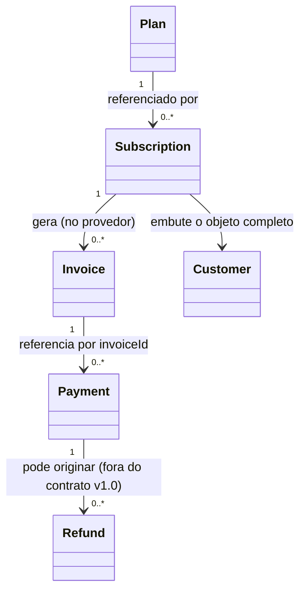

# Modelo canônico da biblioteca

> Este documento descreve o contrato **como implementado hoje** em
> `lib/src/main/java/com/recurrence/contract`. Itens que ainda não existem no
> código, mas que já foram cogitados, ficam isolados na seção 12
> ("Pendências e divergências conhecidas") em vez de misturados ao modelo —
> assim o documento não promete algo que o consumidor da lib não consegue usar.

## 1. Decisões de escopo

### 1.1 Incluído

- criar, consultar, listar (com filtro) e atualizar plano; ativar e inativar
  plano;
- criar, consultar, listar (com filtro) e atualizar assinatura vinculada a
  plano; suspender, reativar e cancelar assinatura;
- consultar fatura e listar faturas de uma assinatura;
- consultar pagamento e listar pagamentos (globalmente ou por fatura, com
  filtro);
- paginação (`PageOptions`/`PageResponse`), opções por chamada
  (`RequestOptions`) e configuração de provedor (`ProviderConfig`).

### 1.2 Fora do escopo em v1.0

- **estorno de pagamento**: o tipo `Refund` existe em
  `contract.domain.Refund`, mas nenhum service do contrato o expõe
  (`InvoiceService` não tem `refund`/`getRefund`/`listRefunds`). Ver seção 8
  e seção 12;
- **busca global de faturas**: só existe `listInvoiceBySubscription`; não há
  `search`/`list` de fatura independente de assinatura;
- **assinante como recurso independente**: não existe `CustomerService`;
  `Customer` só aparece embutido em `Subscription`/`Invoice`/`Payment` (ver
  seção 5 e seção 12 sobre a contradição com a intenção original de não ser
  agregado).

## 2. Visão do domínio



Diferente de um modelo com referências por id, `Subscription` hoje **embute o
objeto completo** de `Plan` e de `Customer` (não `PlanId`/`CustomerId`). Isso
já está sinalizado como pendência no próprio código-fonte — ver seção 12.

Uma fatura representa a cobrança de um ciclo. Um pagamento representa uma
tentativa ou execução financeira dessa cobrança. `Refund` representa a
reversão de um pagamento, mas hoje é um tipo "órfão": existe no domínio, não
é alcançável por nenhum método de service público.

## 3. Tipos de valor compartilhados (`contract.domain.commons`)

```java
record Amount(Integer value, Currency currency) {}

record PlanInterval(PlanIntervalType type, Integer frequency) {}

record PlanTrial(Integer days) {}

final class BillingInfo {
    PaymentMethodType type;
    Card card;
}

final class Card {
    String id;            // cartão já tokenizado/salvo no provedor
    String encrypted;      // cartão criptografado no formato do provedor
    String securityCode;   // CVV, quando o fluxo de criação exigir
}

final class Phone {
    Integer id;
    String area;
    String country;
    String number;
}
```

```java
enum Currency { BRL }
enum PlanIntervalType { MONTH, DAY }
enum PaymentMethodType { CREDIT_CARD }
```

`YEAR` e `WEEK` não integram `PlanIntervalType`: mês e dia são as unidades
compartilhadas pelo levantamento original. `Currency` e `PaymentMethodType`
hoje têm um único valor cada porque só o PagBank está implementado; a entrada
do Mercado Pago vai exigir novos valores (ele aceita outros meios além de
cartão) — ver seção 12.

`BillingInfo` e `Card` são classes (não `record`) deliberadamente, para
permitir novos meios de pagamento e novos campos de cartão sem quebrar o
contrato público.

## 4. Plano

```java
final class CreatePlanRequest {
    String name;
    Amount amount;
    PlanInterval interval;
    Integer billingCycles;
    PlanTrial trial;
    List<PaymentMethodType> paymentMethods;
}

final class UpdatePlanRequest {
    // mesmos campos de CreatePlanRequest, todos opcionais;
    // campo nulo significa "não alterar".
}

final class Plan {
    String id;
    PlanStatus status;
    String name;
    Amount amount;
    PlanInterval interval;
    Integer billingCycles;
    PlanTrial trial;
    List<PaymentMethodType> paymentMethods;
    OffsetDateTime createdAt;
    OffsetDateTime updatedAt;
}

enum PlanStatus { ACTIVE, INACTIVE }
```

`name` é o texto público que identifica a recorrência e corresponde a `name`
no PagBank e `reason` no Mercado Pago. Não há campo de referência externa de
plano em v1.0.

O período gratuito (`PlanTrial.days`) é normalizado como quantidade de dias
até a primeira cobrança. Detalhes exclusivos de um provedor, como retenção da
taxa de adesão, não pertencem ao objeto.

```java
interface PlanService {
    Plan create(CreatePlanRequest plan) throws RecurrenceException;
    Plan create(CreatePlanRequest plan, RequestOptions requestOptions) throws RecurrenceException;

    PageResponse<Plan> list(PageOptions pageOptions) throws RecurrenceException;
    PageResponse<Plan> list(PageOptions pageOptions, PlanFilter planFilter) throws RecurrenceException;

    Plan get(String planId) throws RecurrenceException;

    Plan update(String planId, UpdatePlanRequest plan) throws RecurrenceException;
    Plan update(String planId, UpdatePlanRequest plan, RequestOptions requestOptions) throws RecurrenceException;

    Void activate(String planId) throws RecurrenceException;
    Void activate(String planId, RequestOptions requestOptions) throws RecurrenceException;

    Void deactivate(String planId) throws RecurrenceException;
    Void deactivate(String planId, RequestOptions requestOptions) throws RecurrenceException;
}
```

Ativar e inativar são comandos de intenção. O PagBank usa endpoints próprios;
o Mercado Pago (quando implementado) deve alterar o estado pelo endpoint
geral de atualização. O retorno `Void` (tipo `java.lang.Void`, não `void`) em
`activate`/`deactivate` hoje não carrega nenhuma informação — é um ponto de
atenção listado na seção 12.

`PlanFilter` (busca): `status` e `query`. Ver classe para o mapeamento
proposto por provedor — o filtro de listagem no PagBank ainda precisa ser
confirmado na prática.

## 5. Cliente (assinante) embutido e meio de pagamento

`Customer` é modelado hoje como uma classe com identidade e timestamps
próprios (`id`, `referenceId`, `createdAt`, `updatedAt`), e não só como um
conjunto de dados de criação. Isso diverge da intenção original deste
documento, que era não tratar o assinante como agregado independente — ver
seção 12.

```java
final class Customer {
    String id;
    String referenceId;
    String name;
    String email;
    String taxId;
    OffsetDateTime createdAt;
    OffsetDateTime updatedAt;
    List<Phone> phone;
    BillingInfo billingInfo;
}

final class CustomerRequest {
    String name;
    String email;
    String taxId;
    Phone phone;
    BillingInfo billingInfo;
}
```

Somente cartão (tokenizado ou criptografado, via `Card`/`BillingInfo`)
integra o meio de pagamento portátil hoje. Dados sensíveis de cartão em
texto puro não pertencem ao modelo canônico nem podem ser persistidos pela
biblioteca. `taxId` continua `String` livre — CPF/CNPJ e documentos
equivalentes variam por provedor e essa tipagem ainda não foi revisitada
(ver `PAGBANK_MAPPERS_MELHORIAS.md`, item 14).

## 6. Assinatura

```java
final class CreateSubscriptionRequest {
    String planId;
    String referenceId;
    Amount amount;
    List<BillingInfo> paymentMethod;
    CustomerRequest customer;
}

final class UpdateSubscriptionRequest {
    String planId;
    Amount amount;
    List<BillingInfo> paymentMethod;
    // opcionais; campo nulo significa "não alterar".
}

class Subscription {
    String id;
    String referenceId;
    SubscriptionStatus status;
    Boolean proRata;
    String nextInvoiceAt;      // String, não Instant/OffsetDateTime
    Amount amount;
    Plan plan;                 // objeto completo, não PlanId
    List<BillingInfo> paymentMethod;
    Customer customer;         // objeto completo, não CustomerId
    String expAt;               // String, não Instant/OffsetDateTime
    OffsetDateTime createdAt;
    OffsetDateTime updatedAt;
    BestInvoiceDate bestInvoiceDate;   // record { String day, String month }
}

enum SubscriptionStatus {
    ACTIVE, CANCELED, OVERDUE, PENDING, SUSPENDED, EXPIRED
}
```

```java
interface SubscriptionService {
    Subscription create(CreateSubscriptionRequest subscription) throws RecurrenceException;
    Subscription create(CreateSubscriptionRequest subscription, RequestOptions requestOptions) throws RecurrenceException;

    Subscription get(String subscriptionId) throws RecurrenceException;

    PageResponse<Subscription> list(PageOptions pageOptions) throws RecurrenceException;
    PageResponse<Subscription> list(PageOptions pageOptions, RequestOptions requestOptions) throws RecurrenceException;
    PageResponse<Subscription> list(PageOptions pageOptions, SubscriptionFilter subscriptionFilter) throws RecurrenceException;
    PageResponse<Subscription> list(PageOptions pageOptions, SubscriptionFilter subscriptionFilter, RequestOptions requestOptions) throws RecurrenceException;

    Subscription update(String subscriptionId, UpdateSubscriptionRequest subscription) throws RecurrenceException;
    Subscription update(String subscriptionId, UpdateSubscriptionRequest subscription, RequestOptions requestOptions) throws RecurrenceException;

    Void suspend(String subscriptionId) throws RecurrenceException;
    Void suspend(String subscriptionId, RequestOptions requestOptions) throws RecurrenceException;

    Void cancel(String subscriptionId) throws RecurrenceException;
    Void cancel(String subscriptionId, RequestOptions requestOptions) throws RecurrenceException;

    Void active(String subscriptionId) throws RecurrenceException;
    Void active(String subscriptionId, RequestOptions requestOptions) throws RecurrenceException;
}
```

Mapa mínimo de estados de assinatura:

| Canônico | PagBank | Mercado Pago (planejado) |
| :--- | :--- | :--- |
| `PENDING` | `PENDING` | `pending` |
| `ACTIVE` | `ACTIVE` | `authorized` |
| `SUSPENDED` | `SUSPENDED` | `paused` |
| `CANCELED` | `CANCELED` | `canceled`/`cancelled` |
| `EXPIRED` | `EXPIRED` | `expired` |
| `OVERDUE` | valor observado no PagBank sem equivalente confirmado no Mercado Pago | — |

`SubscriptionFilter`: `status`, `query`, `referenceId` — campos aceitos pelos
dois provedores; `payment_method_type` (só PagBank) e intervalo de
`created_at` (sem suporte na busca do Mercado Pago) ficaram de fora por não
terem equivalência.

## 7. Fatura

```java
final class Invoice {
    String id;
    String status;              // String, não InvoiceStatus — ver observação abaixo
    Integer occurrence;
    Amount amount;
    Subscription subscription;  // objeto completo
    List<Item> items;           // record Item(String type, Amount amount)
    Customer customer;
    Plan plan;
    OffsetDateTime createdAt;
    OffsetDateTime updatedAt;
}

enum InvoiceStatus { UNPAID, PAID }

final class InvoiceFilter {
    InvoiceStatus status;
}

interface InvoiceService {
    Invoice getInvoice(String invoiceId) throws RecurrenceException;
    Payment getPayment(String paymentId) throws RecurrenceException;

    PageResponse<Payment> listPayments(String invoiceId) throws RecurrenceException;
    PageResponse<Payment> listPayments(String invoiceId, PaymentFilter paymentFilter) throws RecurrenceException;
    PageResponse<Payment> listPayments(PageOptions pageOptions) throws RecurrenceException;
    PageResponse<Payment> listPayments(PageOptions pageOptions, PaymentFilter paymentFilter) throws RecurrenceException;

    PageResponse<Invoice> listInvoiceBySubscription(String subscriptionId, PageOptions pageOptions) throws RecurrenceException;
}
```

`InvoiceStatus` hoje só tem dois valores (`UNPAID`, `PAID`) — uma
simplificação forte frente à variedade real de estados de fatura do PagBank
(`WAITING`, `PENDING_ACTION`, `PAID`, `OVERDUE`, `UNPAID`, ...). O próprio
campo `Invoice.status` no domínio é `String`, não o enum `InvoiceStatus`,
então hoje não há garantia de que o valor do provedor caia em um dos dois
valores canônicos — ver seção 12.

Não existe `search` de fatura independente de assinatura: a única forma de
listar é `listInvoiceBySubscription`.

## 8. Pagamento (estorno fora do contrato em v1.0)

```java
final class Payment {
    String id;
    PaymentStatus status;
    OffsetDateTime createdAt;
    OffsetDateTime updatedAt;
    String invoiceId;
    Amount amount;
    BillingInfo paymentMethod;
    Customer customer;
}

enum PaymentStatus { PENDING, APPROVED, UNPAID, DECLINED, REFUNDED }

final class PaymentFilter {
    PaymentStatus status;
    OffsetDateTime createdFrom;
    OffsetDateTime createdUntil;
}
```

Não existe `PaymentService`: as duas únicas operações de pagamento
(`getPayment`, `listPayments`) vivem em `InvoiceService` (seção 7).

```java
final class Refund {
    String id;
    String status;      // String, não RefundStatus
    String type;
    OffsetDateTime createdAt;
    Payment payment;     // objeto completo, não PaymentId
    Amount amount;
}
```

`Refund` existe como tipo de domínio, mas **nenhum método de nenhum service
do contrato o expõe hoje** — não há `refund`, `getRefund` nem `listRefunds`
em `InvoiceService` ou em qualquer outro lugar. Ele foi deliberadamente
tirado do escopo de v1.0 nesta revisão (ver decisão na seção 12): antes de
voltar a fazer parte do contrato público, falta pelo menos:

- confirmar com os dois provedores se o estorno parcial precisa ser
  suportado ou se o contrato mantém a regra de "só estorno total";
- um DTO de request de estorno específico (ver
  `PAGBANK_MAPPERS_MELHORIAS.md`, item 17);
- decidir o método de exposição (`PaymentService` novo ou métodos em
  `InvoiceService`).

`PaymentStatus.UNPAID` cumpre hoje o papel que `DECLINED`/`CANCELED`
cumpriam no desenho anterior deste documento; não há valor de fallback para
estado desconhecido do provedor.

## 9. Opções de requisição, configuração e erros

```java
final class RequestOptions {
    String idempotencyKey;
    Duration timeout;
}
```

A chave de idempotência é anexada como header `x-idempotency-key` pelo
adaptador quando presente (ver `resolveIdempotencyKey` nos services do
PagBank). Sua presença não promete idempotência local nem é validada contra
o conjunto de operações que o provedor realmente suporta.

```java
final class ProviderConfig {
    Duration timeout;      // default 15s
    String token;
    Map<String, String> defaultHeaders;   // default: Content-Type e Accept = application/json
    String backUrl;        // uso exclusivo do Mercado Pago — ver observação abaixo
}

enum Provider { PAGBANK, MERCADO_PAGO }
enum Environment { SANDBOX, PRODUCTION }
```

`backUrl` é a URL de retorno usada pelo Mercado Pago ao final do checkout de
uma assinatura (`back_url` em `POST /preapproval`). O PagBank não tem
equivalente, pois não usa fluxo de redirecionamento nessa etapa. Hoje o campo
vive no `ProviderConfig` compartilhado, e o `PagBankProvider` rejeita a
configuração em tempo de inicialização se `backUrl` vier preenchido
(`PAGBANK_NOT_SUPPORT_BACK_URL`). O efeito prático (falhar alto, em vez de
ignorar silenciosamente) está de acordo com a regra 9 da seção 10, mas o
campo continua sem equivalência de negócio nos dois provedores (critério 1
de `criterios.md`) enquanto estiver num tipo compartilhado — ver seção 12.

**Erros**: a exceção base hoje é `RecurrenceException(message, cause)`, sem
categoria, operação, provedor, status HTTP, código externo ou indicação de
retentativa. O que existe é uma hierarquia de subclasses específicas em
`com.recurrence.exception`:

- `RecurrenceHttpException`
- `RecurrenceProviderException`
- `RecurrenceSerializationException`
- `RecurrenceValidationException`
- `UnsupportedProviderTypeException`

`ErrorCategory` existe como enum, mas está **vazio** — não é usado por
nenhuma exceção hoje. O modelo de erro "rico" (categoria + operação +
provedor + status HTTP + retryable) descrito em versões anteriores deste
documento ainda não foi implementado; é tratado como pendência na seção 12,
não como contrato atual.

## 10. Responsabilidades dos adaptadores

Cada adaptador deve:

1. validar as invariantes canônicas antes de acessar a rede;
2. converter `Amount` exatamente entre unidade mínima e decimal;
3. traduzir unidades, estados, datas, filtros e paginação;
4. compor chamadas quando necessário, como fatura–pagamento no Mercado Pago;
5. preservar identificadores como valores opacos;
6. converter falhas externas para uma exceção de `com.recurrence.exception`;
7. nunca expor DTO externo (`PagBankPlan`, `PagBankSubscription`, ...) pelo
   contrato público;
8. nunca ignorar silenciosamente campo solicitado em criação ou atualização;
9. registrar, sem dados sensíveis, provedor, operação e ID de correlação.

## 11. Matriz de rastreabilidade

| Serviço canônico | PagBank | Mercado Pago | Situação |
| :--- | :--- | :--- | :--- |
| criar/obter/listar/atualizar plano | `/plans` | `/preapproval_plan` | PagBank implementado; Mercado Pago planejado (`MercadoPagoProvider` hoje retorna `null` em todo método) |
| ativar/inativar plano | endpoints de ação | atualização de `status` | idem |
| criar/obter/listar/atualizar assinatura | `/subscriptions` | `/preapproval` | idem |
| suspender/reativar/cancelar assinatura | endpoints de ação | atualização de `status` | idem |
| obter fatura | `/invoices` | `/authorized_payments` | Mercado Pago planejado |
| listar faturas da assinatura | endpoint dedicado | busca por `preapproval_id` | Mercado Pago planejado |
| obter/listar pagamento | `/payments` | `/v1/payments` | Mercado Pago planejado |
| estornar/obter/listar estorno | endpoints de recorrência do PagBank (implementados na camada de service, mas não expostos pelo `InvoiceService`) | API geral de pagamentos | fora do contrato público em v1.0 (seção 8) |

## 12. Pendências e divergências conhecidas

Registradas nesta revisão para decisão futura — nenhuma delas foi corrigida
no código como parte desta tarefa (só documentação):

1. **`Refund` fora do contrato público.** Tipo de domínio existe, nenhum
   service o expõe. Ver seção 8.
2. **`backUrl` no `ProviderConfig` compartilhado** sem equivalência de
   negócio no PagBank (critério 1 de `criterios.md`). Hoje mitigado por
   validação em tempo de configuração; candidato natural é mover para uma
   configuração específica do Mercado Pago (já existe um `MercadoPagoConfig`
   vazio em `com.recurrence.mercadopago`, aparentemente reservado para isso).
3. **`Customer` modelado como agregado com identidade própria**
   (`id`, `createdAt`, `updatedAt`) dentro de um objeto que deveria ser
   apenas "dado embutido", contradizendo a intenção original deste
   documento. Precisa de uma decisão explícita: `Customer` é agregado ou
   projeção?
4. **`Subscription.plan` e `Subscription.customer` embutem o objeto
   completo**, não apenas o id — já sinalizado como dúvida em comentário no
   próprio código-fonte (`Subscription.java`). Afeta payload de resposta e
   custo de serialização.
5. **`Subscription.Builder` aceita `splitEnabled`/`splits` mas a classe não
   os persiste** — o dado informado no builder é descartado
   silenciosamente ao chamar `build()`. Isso é uma inconsistência local com
   a regra 8 da seção 10 ("nunca ignorar silenciosamente campo solicitado"),
   já que o próprio domínio embutido tem esse comportamento.
6. **`proRata`, `expAt` (String), `bestInvoiceDate` e split de pagamento**
   são campos de `Subscription` de origem claramente PagBank, incorporados
   ao modelo canônico sem confirmação de equivalência no Mercado Pago
   (pergunta obrigatória de `criterios.md`: "existe regra dependente de
   país, conta ou meio de pagamento?").
7. **`Invoice.status` é `String`**, não o enum `InvoiceStatus` — não há
   garantia estrutural de que o adaptador normalize para um dos dois valores
   canônicos antes de devolver ao consumidor da lib.
8. **Nenhum enum de status tem valor de fallback** (`UNKNOWN`/similar) para
   estado desconhecido do provedor — pergunta obrigatória de
   `criterios.md` ("Como um valor novo ou desconhecido será preservado?")
   ainda sem resposta no tipo.
9. **Modelo de erro rico (categoria/operação/provedor/status HTTP/retry)**
   ainda não implementado; `ErrorCategory` está vazio. Ver seção 9.
10. **Camada de implementação PagBank fora de sincronia com o `contract`
    atual.** Fora do escopo desta revisão (que é `contract` +
    documentação), mas relevante o suficiente para registrar: hoje
    `PagBankPlanService`/`PagBankInvoiceService` têm trechos de código
    incompletos (não compilam) e `PagBankSubscriptionService` implementa
    assinaturas (`create(Subscription, ...)`, tipo `RequestResponse`) que
    não existem mais no `SubscriptionService`/`contract.infra` atuais. A
    lib não compila no estado atual do working tree.
